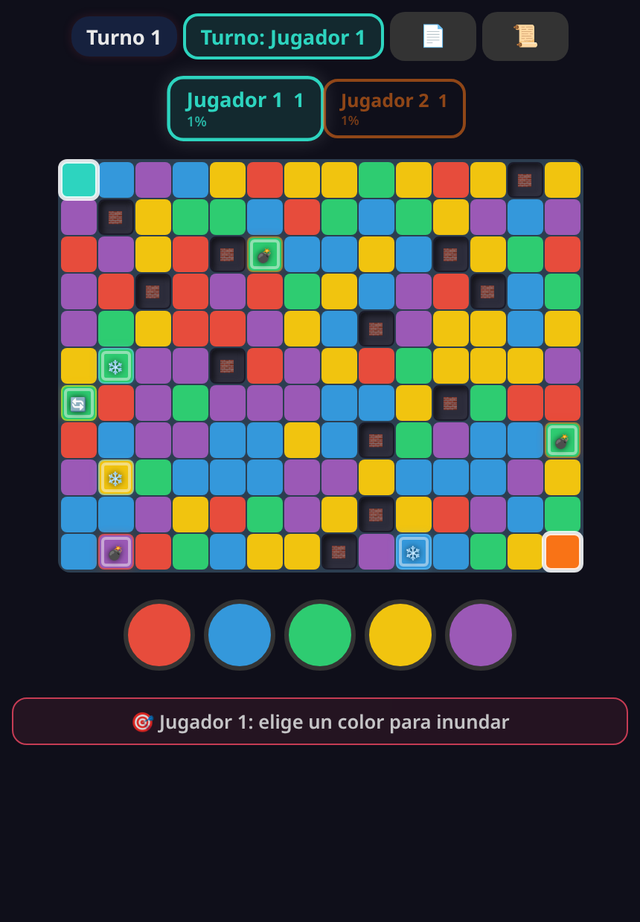

# 🌊 Flood-It Party

> Conquista territorio inundando colores desde tu esquina, contra amigos o contra la IA. Basado en el paper de NP-dureza de Flood-It.

**[▶ Jugar ahora](https://juliangdeveloper.github.io/floodit-party/)** · gratis, en el navegador, sin instalar

## Cómo se juega
- 2 a 4 jugadores en un mismo dispositivo; cada puesto puede ser humano o IA (fácil, media o difícil).
- Cada jugador empieza en una esquina. En tu turno eliges un color y tu territorio absorbe todas las casillas libres de ese color conectadas a él.
- Si el color que eliges no captura nada, pierdes el turno.
- Muros 🧱 que nadie puede capturar y power-ups: 💣 bomba, ❄️ congelar a un rival, ⚡ robar casillas y 🔄 doble puntuación.
- Ajustas colores (4 a 6), tamaño del tablero y densidad de muros.
- Gana quien capture más casillas cuando ya no quedan libres o nadie puede capturar más.

## El paper
Flood-It es NP-difícil: [Clifford, Jalsenius, Montanaro y Sach, *The Complexity of Flood Filling Games* (arXiv:1001.4420)](https://arxiv.org/abs/1001.4420). El botón 📄 del juego lo resume.

## Stack
Un solo `index.html` con HTML, CSS y JavaScript vanilla. Sin dependencias ni servidor.

## Otros juegos de fiesta
- 💥 [Clickomania Party](https://github.com/juliangdeveloper/clickomania-party) · [jugar](https://juliangdeveloper.github.io/clickomania-party/)
- 🔷 [HexaSort Party](https://github.com/juliangdeveloper/hexasort-party-v2) · [jugar](https://juliangdeveloper.github.io/hexasort-party-v2/)
- 🌿 [VidaBalance](https://github.com/juliangdeveloper/vidabalance-v2) · [jugar](https://juliangdeveloper.github.io/vidabalance-v2/)

---

Más proyectos: https://juliangdeveloper.github.io/

Hecho con ❤️ y 🌊
